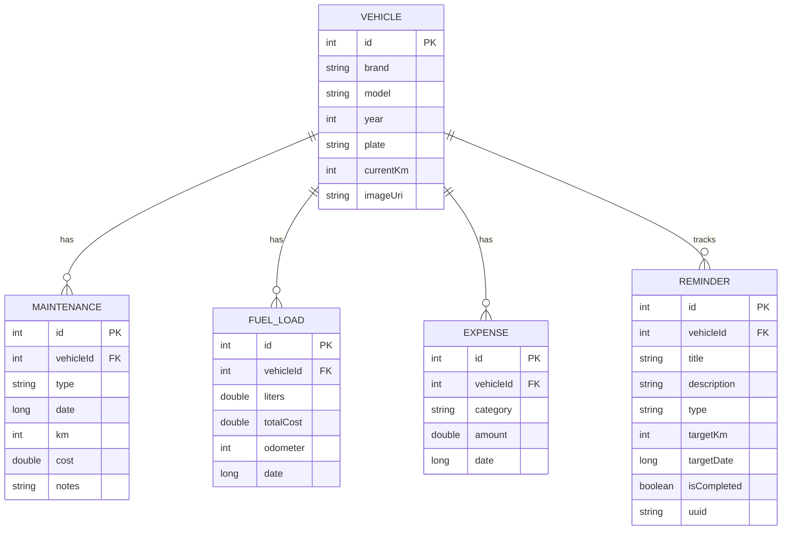

# AutoCare

Comprehensive Android application for vehicle management, tracking maintenance, expenses, and fuel loads.

## Database Schema (ERD)

## Funcionalidades Principales

- **Seguridad Biométrica**: Acceso protegido mediante huella dactilar o credenciales del dispositivo. Configurable desde la pantalla de Ajustes (activar para requerir autenticación, desactivar para acceso directo).
- **Gestión de Vehículos**: Soporte para múltiples vehículos con registro de marca, modelo, año y kilometraje actual. Incluye un selector intuitivo con resaltado del vehículo activo.
- **Monetización y Versión Pro**:
    - **Integración con AdMob**: Los usuarios de la versión gratuita ven anuncios de banner no intrusivos en el Dashboard e Historial.
    - **Simulación de Upgrade Pro**: Opción en Ajustes para alternar entre el modo gratuito y Pro.
    - **Funciones Premium**: El modo Pro elimina la publicidad y desbloquea la **Generación de Reportes PDF** profesionales.
    - **Diseño Anti-Jumps**: Espacios reservados para anuncios que evitan saltos bruscos en la interfaz al cargar la publicidad.
- **Sistema de Recordatorios Inteligentes**:
    - Alertas basadas en **Kilometraje** (ej. próximo cambio de aceite).
    - Alertas basadas en **Tiempo/Fecha** (ej. vencimiento de seguro o revisión técnica).
    - **Monitoreo Multi-Vehículo**: Notificaciones en el panel principal sobre tareas pendientes en otros vehículos registrados.
    - **Notificaciones del Sistema**: Alertas locales automáticas para recordatorios con severidad `CRÍTICA`.
    - Cálculo dinámico de severidad: `CRÍTICO` (vencido), `ADVERTENCIA` (próximo) y `AL DÍA`.
- **Seguimiento de Mantenimiento**: Registro detallado de servicios, reparaciones y costos asociados.
- **Control de Combustible**: Monitoreo de consumos (km/L) y gastos en gasolineras.
- **Estadísticas Financieras**: Resumen de gastos mensuales categorizados.
- **Documentación Fotográfica**: Integración con cámara y galería para fotos de vehículos.
- **Interfaz Moderna**: Diseño basado en Material 3 con paleta automotriz profesional (tipografía Poppins). Consistencia visual mediante el uso de bordes finos (1dp) en tarjetas y estados de selección optimizados (`ACGray`).
- **Configuración Persistente**: Guardado automático de preferencias de usuario como el tema oscuro y el estado de la seguridad biométrica.
- **Robustez de Datos**: Lógica de emparejamiento entre mantenimientos y recordatorios validada mediante una suite de pruebas unitarias.

## Guía de Uso y Ejemplos

### 1. Configurar un Recordatorio de Mantenimiento
Cuando realizas un servicio, puedes programar el siguiente automáticamente:
*   **Ejemplo**: Al registrar un "Cambio de Aceite" a los 50,000 km, activa la opción "Programar recordatorio" y establece el objetivo en 60,000 km o en 6 meses.
*   **Resultado**: La aplicación te mostrará una alerta naranja cuando llegues a los 59,500 km o falten 7 días para la fecha.

### 2. Panel de Control (Dashboard)
El dashboard actúa como tu centro de mando:
*   **Icono de Campana**: En la barra superior, una campana con un contador rojo te indica cuántas tareas requieren tu atención en el vehículo actual.
*   **Alerta Multi-Vehículo**: Si tienes más de un auto registrado, el Dashboard te avisará si alguno de los otros vehículos tiene recordatorios vencidos o próximos, permitiéndote cambiar de perfil rápidamente.
*   **Tarjetas de Alerta**: Cada recordatorio próximo muestra exactamente qué condición está por cumplirse (*"Faltan 200 km"* o *"Vencido hace 2 días"*). Las tarjetas cuentan con bordes definidos para facilitar su lectura.

### 3. Historial y Edición Independiente de Recordatorios
*   **Historial con Enlace a Recordatorios:** Al navegar por la pestaña de Mantenimientos en el Historial de cualquier vehículo, la aplicación muestra de un vistazo si cada mantenimiento tiene un recordatorio activo mediante un **ícono de campana/notificación** junto al título. Al presionar este ícono, serás redirigido directamente a la pantalla de edición del recordatorio asociado para actualizar sus metas, guardarlo o completarlo.
*   **Edición de Recordatorios Directa:** Si deseas modificar o postergar una alerta existente, pulsa directamente sobre la tarjeta de alerta en el Dashboard principal. Esto te llevará a la pantalla de edición dedicada donde podrás cambiar el kilometraje, ajustar la fecha, eliminar el recordatorio o marcarlo como completado para archivarlo.

