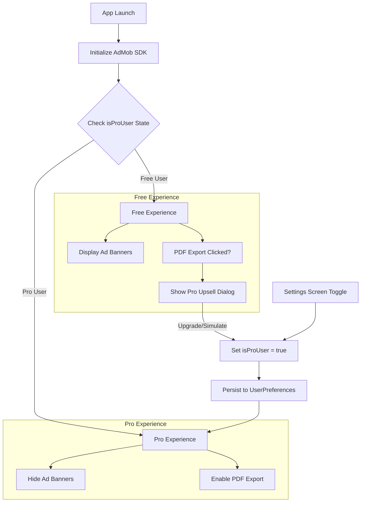
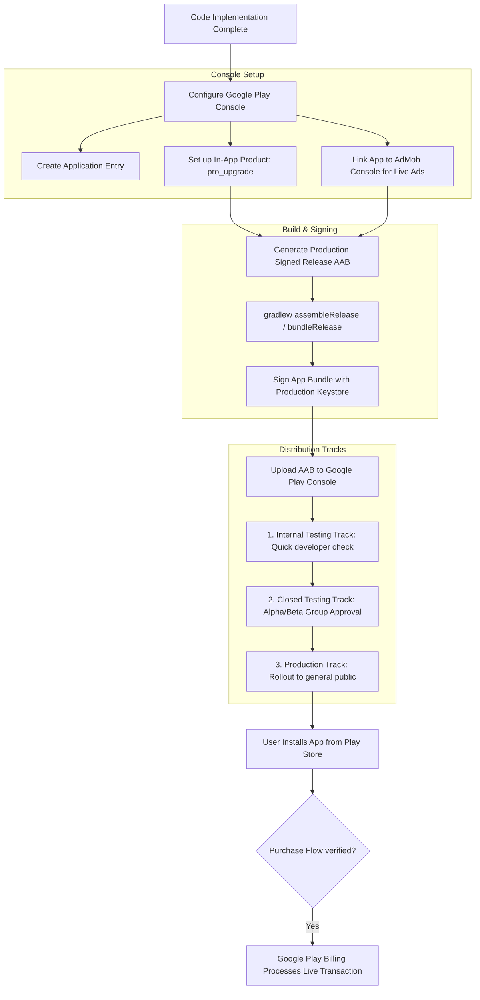

# Implementation Plan: Monetization & Distribution (AdMob + Pro Upgrade)

This document outlines the strategy and current implementation for refactoring AutoCare to support a "Freemium" model using Google AdMob for revenue and Google Play Billing for a "Pro" upgrade.

## 1. Overview
AutoCare uses a tiered freemium model:
*   **Free Version:** Core maintenance tracking, fuel logs, and basic statistics. Supported by AdMob banner ads.
*   **Pro Version (IAP):** Ad-free experience and exclusive professional PDF report exports.

## Process Flow Diagrams

### 1. App Runtime Monetization Flow

### 2. Google Play Store Publishing & Distribution Process

## 2. Technology Stack
*   **Google AdMob SDK:** For delivering banner ads (`com.google.android.gms:play-services-ads:25.5.0`).
*   **Google Play Billing Library:** Prepared for handling one-time In-App Purchases (IAP) (`com.android.billingclient:billing-ktx:9.1.0`).
*   **SharedPreferences:** Persistent local state caching for the `isProUser` preference to ensure instantaneous UI rendering and ad gating across sessions.

## 3. UI/UX Strategy: Ad Placement & Stability
To comply with Google AdMob policies and prevent poor UX (accidental clicks due to layout shifts), we implement **Reserved Ad Spaces**.

### Strategy: Pre-allocated UI Containers
*   **Banner Slots:** Instead of injecting ads dynamically and pushing other elements out of the way, Compose layouts render the standard adaptive or smart banner containers (`AdBanner`).
*   **Prevention of Layout Jumps:** If `isProUser` is false, the container pre-allocates space. If true, the space is removed entirely.

### Placements:
1.  **Dashboard Screen:** Positioned inside the bottom bar layout above the system navigation bar for non-Pro users.
2.  **History Screen:** Positioned neatly above the tab content view.

## 4. Monetization Logic & State Management

### State Flow:
1.  **App Launch:** Initialize the Google Mobile Ads SDK inside `MainActivity`. The `AndroidManifest.xml` is configured with a standard AdMob test application metadata tag (`ca-app-pub-3940256099942544~3347511713`) to prevent initialization crashes.
2.  **State Persistence:** `UserPreferences` exposes an `isProUser` property backed by local storage.
3.  **UI Propagation:** The `isProUser` flag is propagated from the root navigation graph (`AutoCareNavGraph`) down into the individual screen contents.

## 5. "Pro" Feature Gatekeeping & Simulation
The following features are gated behind the premium check:
*   **PDF Report Generation:** Attempting to click the export button on either the Dashboard or History screen triggers an attractive **Pro Upgrade Upsell Dialog** unless `isProUser` is true.
*   **Pro Upgrade Simulation Toggle:** To facilitate seamless testing, an interactive switch toggle is provided in the **Settings Screen**. Users can toggle the Pro tier on/off to immediately witness the removal/injection of ads and the unlocking of PDF generation features.

## 6. Next Steps for Production
1.  **Production BillingClient Implementation:** Replace the simulation toggle in Settings with a concrete Google Play Billing client mapping purchase flows.
2.  **Production AdMob IDs:** Swap out the test Application ID in `AndroidManifest.xml` and the test Banner Unit ID in `AdComponents.kt` with live production identifiers generated in the Google AdMob Console.
