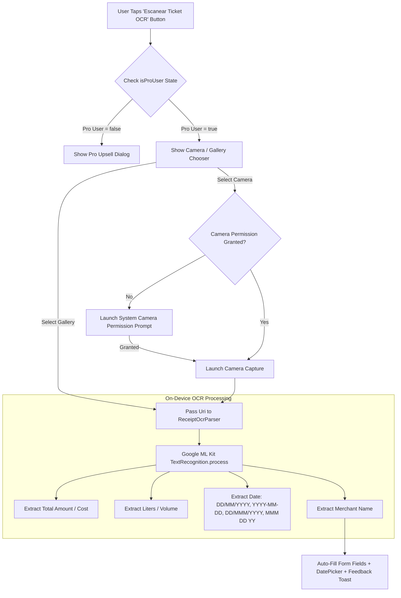

# Implementation Plan: Pro OCR Receipt Extractor (Google ML Kit + Jetpack Compose)

This document outlines the architecture, ML Kit text recognition pipeline, Pro monetization gating, camera/gallery UI integration, runtime camera permission checks, and expanded date extraction heuristics for automatically parsing physical fuel/maintenance/expense receipts into AutoCare.

---

## 1. Overview & Key Objectives
AutoCare provides **Pro Users** (`isProUser == true`) with a 1-click **OCR Receipt & Ticket Extractor** powered by **Google ML Kit Text Recognition** (`play-services-mlkit-text-recognition:19.0.1`).

### Key Features:
1.  **100% On-Device & Private**: All OCR text recognition runs locally on the device using Google ML Kit. No receipt images or financial data leave the device.
2.  **Pro Exclusive Gating**: The **"Escanear Ticket (OCR)"** button is gated behind `isProUser == true`. Free users clicking the button see the Pro Upgrade Upsell Dialog.
3.  **Runtime System Camera Permission Handling**: Automatically checks `Manifest.permission.CAMERA` when selecting "Cámara". If not granted, requests permission via system prompt (`ActivityResultContracts.RequestPermission()`) before launching camera capture.
4.  **Multi-Format Date Extraction (`ReceiptOcrParser.kt`)**:
    *   **Numeric Patterns**: `DD/MM/YYYY`, `DD-MM-YYYY`, `DD.MM.YYYY`, `YYYY-MM-DD`, `YYYY/MM/DD`, `DD/MM/YY`, `DD-MM-YY`
    *   **Textual Month Patterns (Spanish & English)**: `DD/MMM/YYYY`, `DD-MMM-YYYY`, `DD MMM YYYY`, `MMM DD, YY`, `MMM DD YYYY` (e.g. `15/Ene/2026`, `15-Jan-2026`, `Jan 15, 26`, `15/01/2026`).
    *   Auto-populates the form's `selectedDate` and DatePicker state directly.
5.  **Smart Text Parsing Heuristics**:
    *   **Total Amount / Cost**: Searches for keywords (`TOTAL`, `IMPORTE`, `MONTO`, `NETO`, `$`) and parses the primary decimal value.
    *   **Fuel Volume (Liters)**: Searches for volume keywords (`LITROS`, `L`, `GALONES`) and extracts liters amount.
    *   **Vendor / Merchant Name**: Extracts shop header text (e.g. PEMEX, SHELL, OXXO GAS, TALLER MECANICO).
6.  **1-Tap Form Auto-Fill**: Automatically populates `liters`, `totalCost`, `amount`, `notes`, and `date` in `AddFuelScreen`, `AddMaintenanceScreen`, and `AddExpenseScreen`.

---

## 2. Process Flow Diagram

---

## 3. UI/UX Integration Across Form Screens

| Screen | OCR Action Button | Auto-Filled Fields |
| :--- | :--- | :--- |
| **`AddFuelScreen`** | **Escanear Ticket (OCR)** | `liters`, `totalCost`, `selectedDate` |
| **`AddMaintenanceScreen`** | **Escanear Ticket (OCR)** | `cost`, `notes` (Vendor/Type), `selectedDate` |
| **`AddExpenseScreen`** | **Escanear Ticket (OCR)** | `amount`, `notes` (Category/Vendor), `selectedDate` |

---

## 4. Verification & Build
- Verify syntax and build with `./gradlew :app:assembleDebug`.
